# Blank påtegning – fiktiv kommunikationsplan for FSR

Et fiktivt kampagnekoncept til FSR – danske revisorer, lavet som en case. FSR lader sine unge medlemmer "revidere" værdien af deres eget medlemskab.

**Alle tal, indsigter og citater er fiktive og opstillet til formålet.**

## Se præsentationen
- **Direkte her på GitHub:** scroll ned – alle 12 slides vises som billeder nedenfor.
- **Som PDF:** [presentation/blank-paategning-fsr.pdf](presentation/blank-paategning-fsr.pdf)
- **Som interaktiv præsentation:** download repoet, og åbn `presentation/index.html` i en browser. Bladr med piletasterne, klik eller tryk `f` for fuld skærm. (GitHub viser ikke HTML-sider direkte i private repos.)

## Indhold
- `project/deck.json` – slideoversigt, rækkefølge og skrifttyper
- `project/deck.css` – fælles design for slides
- `project/slides/*.html` – én fil pr. slide (12 slides)
- `presentation/` – den færdige præsentation: `index.html`, PDF, slidebilleder og skrifttyper (Libre Baskerville og Public Sans, SIL Open Font License)

## Struktur
1. Udfordring og målgruppe (unge revisorer, 22–32 år)
2. Indsigter og fakta (fiktive)
3. Strategisk ramme: formål, mål og budskab
4. Konceptet "Blank påtegning"
5. Produkter: Dit Medlemsregnskab · videoserien · AI-assistenten "Spørg FSR"
6. Tidsplan 2027, AI/GDPR og forankring

## Slides

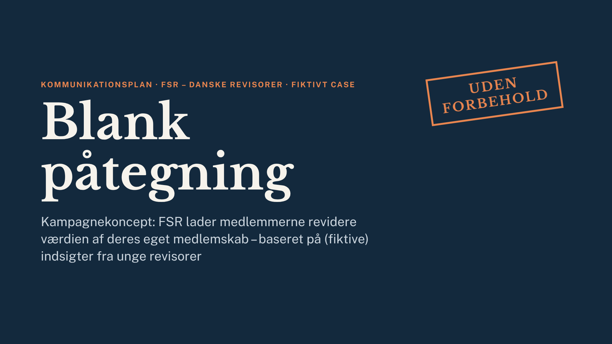

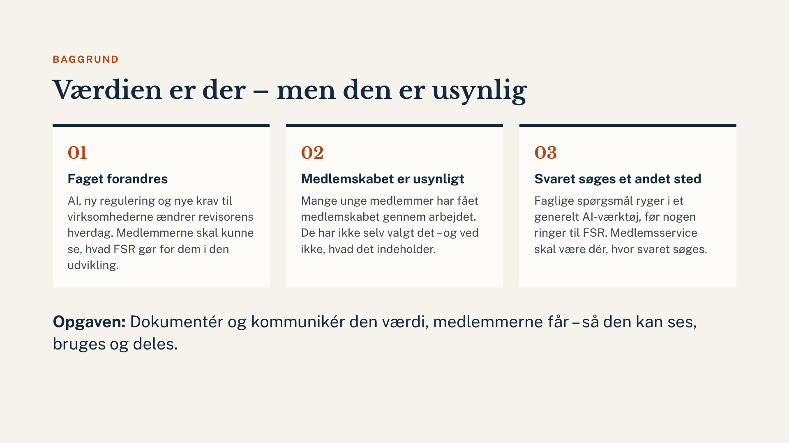

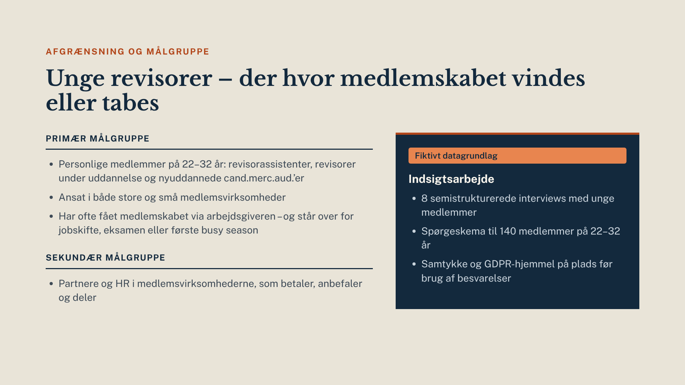

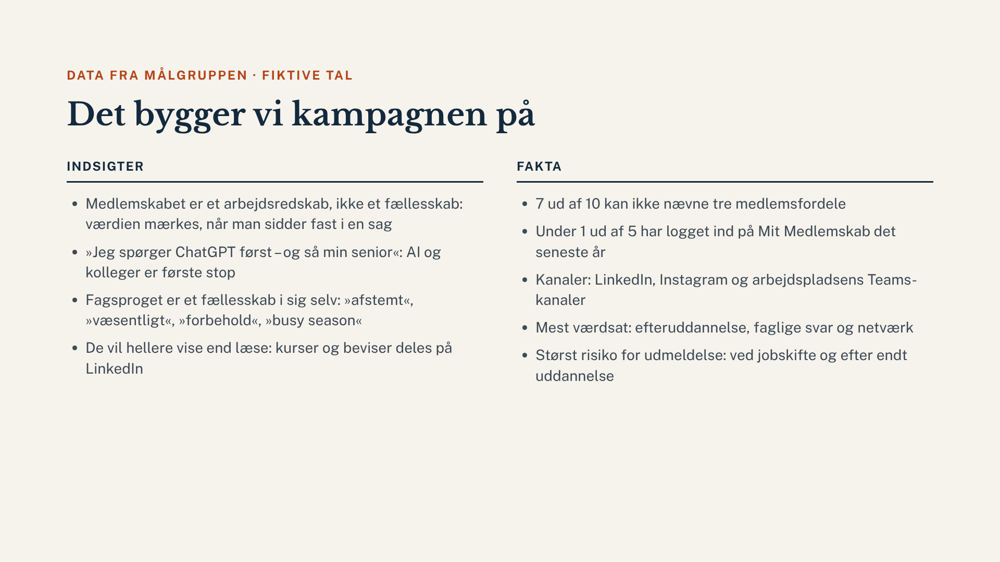

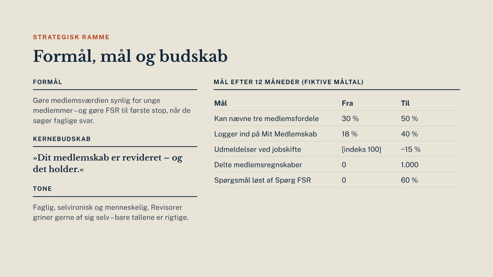

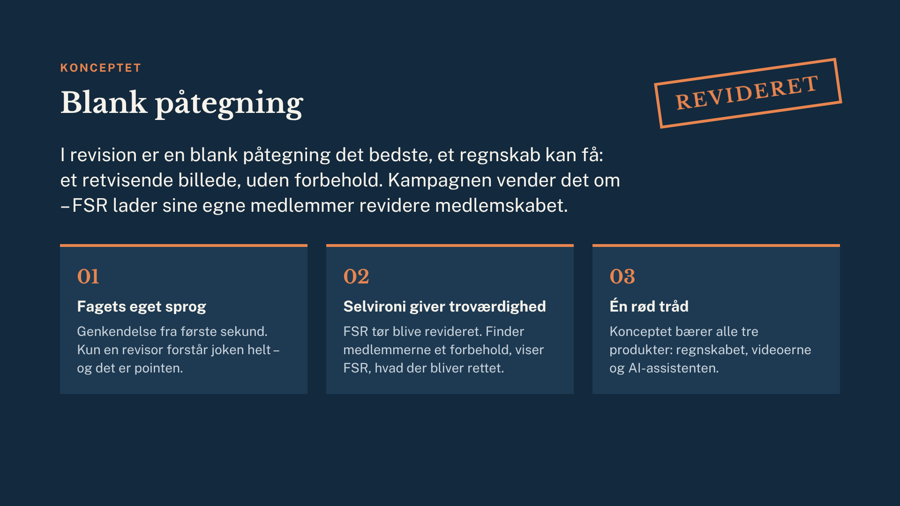

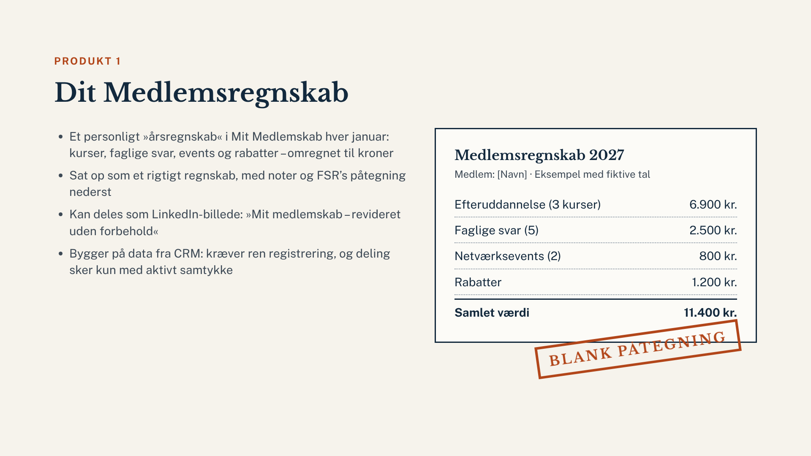

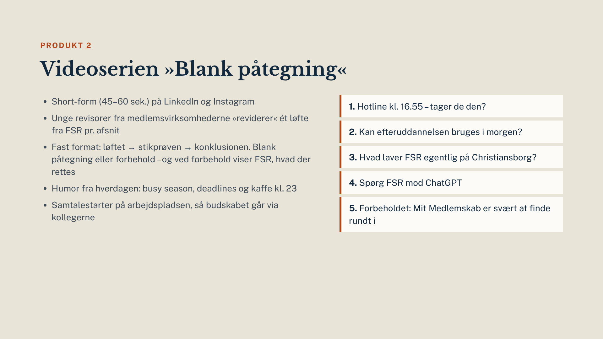

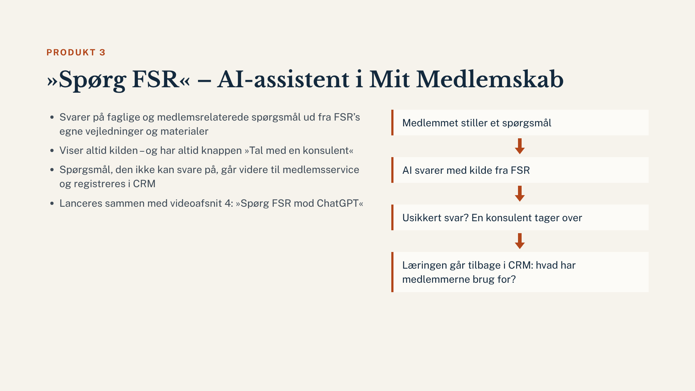

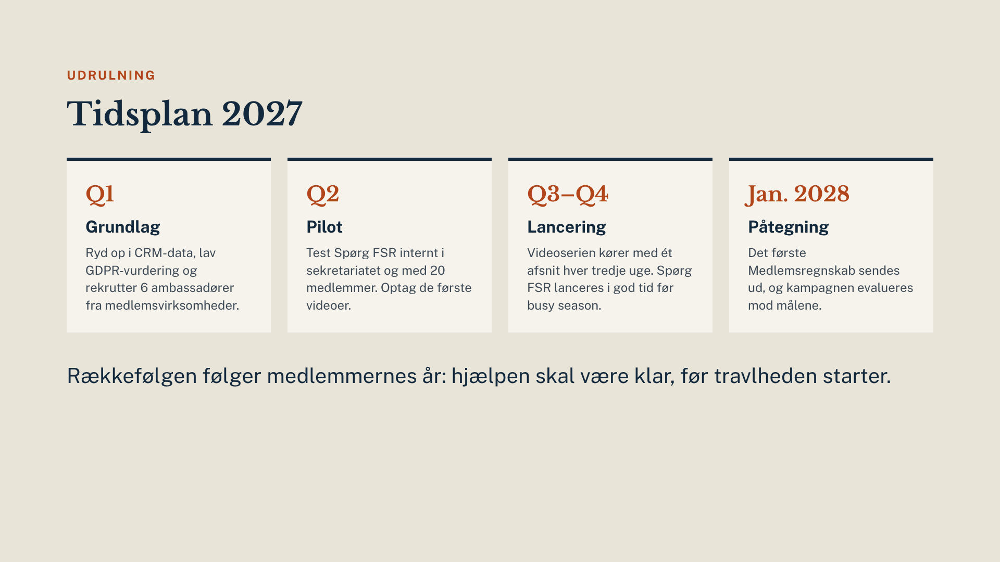

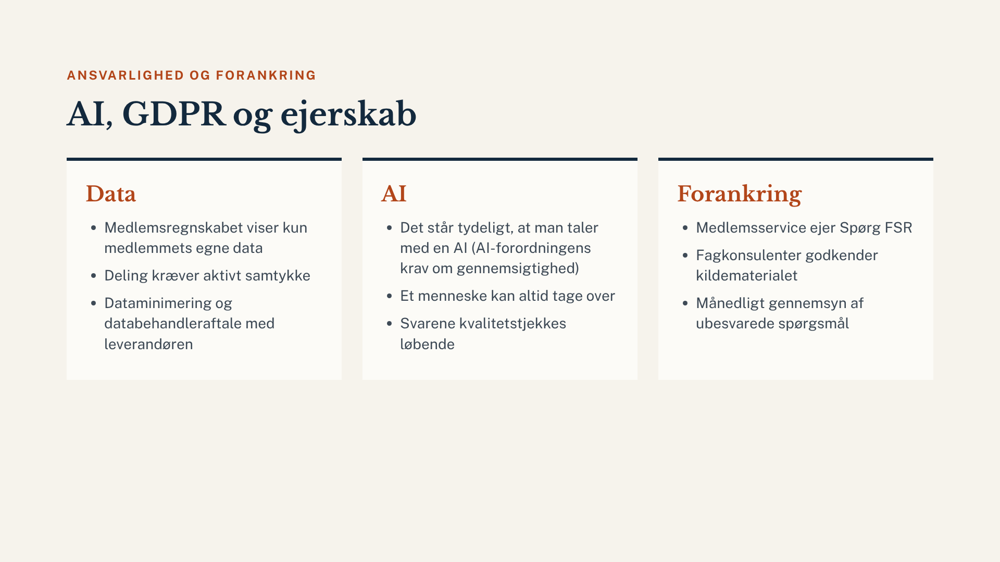

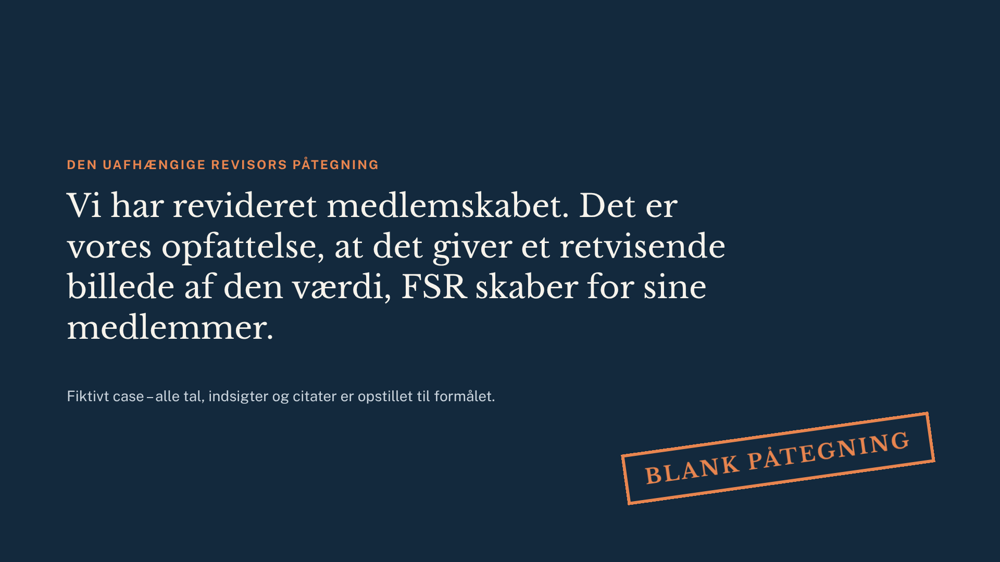

© Rebecca Hellner. Alle rettigheder forbeholdes. Må ikke kopieres eller genbruges uden tilladelse.
